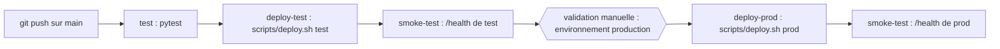

# Pipeline CI/CD

> Partie « Pipeline CI/CD ». Rédigée à partir du code du dépôt (`.github/workflows/ci.yml`, `scripts/`) ; à relire par l'auteure de la pipeline.

## 1. Vue d'ensemble

Un `git push` sur la branche `main` déclenche une pipeline GitHub Actions qui teste le code, le déploie en `test`, vérifie que le
déploiement répond, puis le déploie en `prod` **après validation**, sans interruption de service.

Chaque étape dépend de la précédente (`needs`) : si l'une échoue, les suivantes ne s'exécutent pas.

## 2. Déclencheur et exécuteur

| Élément | Choix |
|---|---|
| Déclencheur | `push` sur `main` uniquement |
| Exécuteur | **runner auto-hébergé** (`runs-on: self-hosted`), installé sur le Mac qui héberge aussi le cluster kind |
| Pourquoi | les déploiements visent un cluster local : un runner hébergé par GitHub n'y aurait pas accès |

Conséquences à connaître :

- **Le runner doit être en ligne** (Mac allumé, Docker lancé, application du runner démarrée, veille désactivée par exemple avec `caffeinate -d`).
  Sinon les jobs restent « en attente » sans erreur. L'état se lit dans *Settings*, *Actions*, *Runners* (`Idle` = prêt).
- **Le dépôt est public** : la pipeline ne se déclenche **pas** sur `pull_request`. Avec un runner auto-hébergé, une pull request
  venue d'un tiers pourrait faire exécuter du code sur la machine. Seul ce qui est fusionné sur `main` (donc relu) s'exécute.
- Les déploiements vont dans le cluster **de la machine qui porte le runner**.

## 3. Les étapes (jobs)

| Job | Rôle | Commande |
|---|---|---|
| `test` | tests unitaires dans un environnement virtuel propre | `pip install -r requirements-dev.txt` puis `pytest` |
| `deploy-test` | déploie le commit dans `test` | `./scripts/deploy.sh test "${GITHUB_SHA::7}"` |
| `smoke-test` | vérifie que `test` répond | `./scripts/smoke-test.sh test` |
| `deploy-prod` | déploie le **même** commit en `prod`, après validation | `./scripts/deploy.sh prod "${GITHUB_SHA::7}"` puis `./scripts/smoke-test.sh prod` |

Les tests sont dans `tests/` (`test_app.py` : routes de base ; `test_photos.py` : envoi, lecture, suppression, doublons, comparaison, routage
par shard, comportement quand la base est indisponible, en-têtes de cache). `pytest.ini` fixe `pythonpath = app` pour importer le code.

## 4. Image et version

- **Tag = 7 premiers caractères du SHA du commit** (`${GITHUB_SHA::7}`) : un tag unique par commit. Kubernetes ne relance des pods que
  si le modèle de pod change : un tag identique d'un déploiement à l'autre ne provoquerait aucun rollout.
- Le tag est aussi passé à l'image (`--build-arg APP_VERSION`) : la route `/` renvoie ce `version`, ce qui permet de voir quelle version
  répond pendant un déploiement.
- **On construit une fois, on déploie plusieurs fois** : `deploy.sh` ne reconstruit l'image que si elle n'existe pas déjà. En `prod`, c'est donc
  **exactement l'image testée** en `test`.

## 5. Le script `scripts/deploy.sh <test|prod> <tag>`

| Étape | Ce qui se passe | Pourquoi |
|---|---|---|
| Validation | l'environnement doit être `test` ou `prod`, un tag est exigé | éviter d'agir par erreur sur un autre namespace |
| Image | construite si absente, puis chargée dans kind (`kind load docker-image`) | le nœud kind n'a pas accès au Docker local sinon |
| Tag | `kustomize edit set image` écrit le tag dans l'overlay | le Deployment **et** le Job utilisent la même image |
| 0. Bases | crée le namespace, applique les `Cluster` (label `component=database`), attend qu'ils soient `Ready` | dans un environnement neuf, le Job de migration a besoin des Secrets créés avec les bases |
| 1. Ancien Job | supprimé | un Job existant ne peut pas être modifié (son image change à chaque déploiement) |
| 2. Migration | applique **seulement** le Job (`-l component=migration`) et attend sa fin (180 s) ; en cas d'échec, affiche les journaux et **arrête tout** | l'ancienne version continue de servir ; le déploiement n'a pas lieu |
| 3. Déploiement | applique tout l'overlay, puis attend le rollout de l'application et du cache | la pipeline n'est verte que si toute la chaîne est prête |

Les sélections par label (`-l component=...`) permettent d'appliquer une partie seulement d'un overlay Kustomize.

## 6. Déploiement sans interruption

| Mécanisme | Fichier | Effet |
|---|---|---|
| `RollingUpdate` avec `maxSurge: 2`, `maxUnavailable: 0` | `k8s/base/deployment.yaml` | de nouveaux pods démarrent **avant** que les anciens soient arrêtés ; jamais moins de pods qu'avant |
| `readinessProbe` sur `/health` | `deployment.yaml` | un pod ne reçoit du trafic que lorsqu'il répond |
| `preStop: sleep 10` | `deployment.yaml` | l'ancien pod continue de répondre dix secondes pendant qu'on le retire des Services |
| Migrations compatibles avec l'ancienne version | `app/migrations/` | les deux versions tournent en même temps sur la même base (voir `03-database.md`) |
| `/health` volontairement sans accès aux bases | `app/app.py` | une panne de base ne rend pas tous les pods « non prêts » |

Mesure : `./scripts/watch.sh <test|prod>` envoie une requête toutes les 0,2 s et compte les erreurs (bilan à `Ctrl+C`). Lors de la
validation du milestone 2, 401 requêtes consécutives pendant un rollout ont toutes reçu `200`.

## 7. Scénarios d'échec

| Scénario | Ce que fait la pipeline |
|---|---|
| tests unitaires qui échouent | `test` est rouge ; `deploy-test` n'est pas lancé |
| image défectueuse (le pod ne devient jamais prêt) | `rollout status` expire (120 s), la pipeline est rouge ; les anciens pods servent toujours (`maxUnavailable: 0`) |
| migration en échec | la pipeline est rouge **avant** le rollout ; les journaux du Job sont affichés ; l'ancienne version continue de servir |
| `smoke-test` de `test` en échec | `prod` n'est pas déployé |
| échec en `prod` | l'ancienne version continue de servir ; retour arrière manuel possible : `kubectl rollout undo deployment/photo-service -n prod` |

## 8. Validation avant la production

Le job `deploy-prod` déclare `environment: production`. Pour qu'il attende une **validation manuelle**, des relecteurs doivent être
configurés dans *Settings*, *Environments*, *production*, *Required reviewers*. **À vérifier dans le dépôt** : sans cette configuration,
le déploiement en production part automatiquement après le smoke-test.

## 9. Secrets et sécurité

- Aucun secret n'est stocké dans le dépôt : les mots de passe des bases sont créés par l'opérateur dans des Secrets Kubernetes, lus par les pods.
- Les fichiers d'identifiants (kubeconfig d'un cluster distant) se trouvent dans `secrets/`, **ignoré par Git**.
- Pour un cluster distant, le kubeconfig serait un **secret GitHub Actions** (voir `01-cluster.md`, section 9).

## 10. Limites

- Les images ne passent pas par un registre : elles sont chargées directement dans le nœud kind (limite de l'environnement local).
- Un seul cluster héberge `dev`, `test` et `prod` : l'isolation est logique (namespaces), pas matérielle.
- La pipeline dépend d'une seule machine (le runner) : si elle est éteinte, rien ne se déploie.
- Le retour arrière en production est manuel.

## 11. Dépannage

| Symptôme | Cause probable | Remède |
|---|---|---|
| jobs « Queued » qui n'avancent pas | runner hors ligne | l'allumer, vérifier `Idle` dans *Runners* |
| `kind load` échoue | Docker arrêté | démarrer Docker Desktop |
| `no matches for kind "Cluster"` dans `deploy.sh` | l'opérateur n'est pas installé sur le cluster du runner | `kubectl apply --server-side -k k8s/platform/cnpg` |
| migration en échec | base pas prête, ou SQL invalide | `kubectl logs job/photo-migrate -n <env>` |
| `deploy-prod` ne démarre pas | validation en attente (si configurée) | approuver dans l'onglet Actions |
| pods de l'application en `CreateContainerConfigError` | le Secret `photo-secret` n'existe pas dans ce namespace | le créer (voir `01-cluster.md`, section 6), les pods redémarrent seuls |
