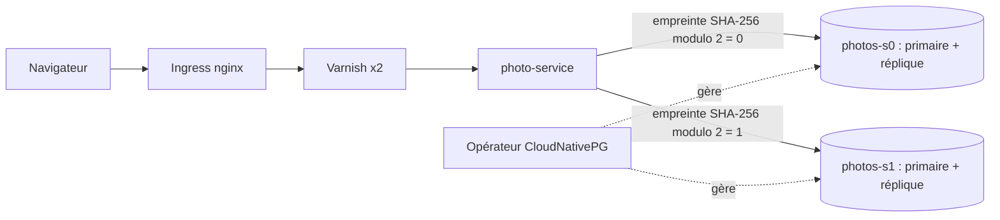

# Base de données

> Partie « Base de données » de la documentation. Tous les fichiers cités sont dans ce dépôt.
> Les sorties de commandes ci-dessous proviennent de tests réels sur le cluster local (kind).

## 1. Vue d'ensemble

L'application stocke ses photos dans **PostgreSQL**, réparti sur **deux shards**. Chaque shard est un petit cluster PostgreSQL
**répliqué** (un primaire et une réplique), géré par l'opérateur **CloudNativePG**. Un cache **Varnish** (deux pods) est placé
devant l'application. L'application choisit le shard d'une photo à partir de l'empreinte SHA-256 de son contenu.



| Élément | Où | Rôle |
|---|---|---|
| Opérateur CloudNativePG 1.30.1 | `k8s/platform/cnpg/` (namespace `cnpg-system`) | installe les types d'objets PostgreSQL et gère réplication, basculement, volumes |
| `Cluster` `photos-s0` et `photos-s1` | `k8s/base/db-cluster/`, `k8s/base/db-cluster-s1/` | un shard chacun : 2 instances, 2 Gio de stockage par instance |
| Services `photos-s0-rw`, `-ro`, `-r` (idem `photos-s1-...`) | créés par l'opérateur | `-rw` : le primaire (écritures) ; `-ro` : les répliques ; `-r` : toutes les instances |
| Secrets `photos-s0-app`, `photos-s1-app` | créés par l'opérateur | identifiants de l'application (clé `uri` : adresse de connexion complète) |
| Job `photo-migrate` | `k8s/base/migrate-job.yaml` | applique les migrations de schéma sur chaque shard |
| Varnish | `k8s/base/cache/` | cache HTTP répliqué devant l'application |
| StatefulSet `db` | `k8s/base/db/` | première brique d'apprentissage (une seule instance), utilisée uniquement dans `dev` |


**Qu'est-ce qu'un opérateur ?** Une extension de Kubernetes composée de deux parties : une **CRD** (*CustomResourceDefinition*),
qui ajoute un nouveau type d'objet (ici `Cluster`, dans le groupe `postgresql.cnpg.io`), et un **contrôleur** qui compare en
permanence l'état voulu (« je veux 2 instances ») à l'état réel et agit (créer un pod, copier les données, promouvoir une réplique).
C'est le même principe que celui d'un Deployment, appliqué à une base de données.


## 3. Persistance

Une base de données doit survivre à la disparition de son pod. Un **StatefulSet** donne à chaque pod une identité stable
(`db-0`) et **son propre volume** (`volumeClaimTemplates`), qui se rattache au même pod à chaque redémarrage. Le **Service
headless** (`clusterIP: None`) donne à chaque pod un nom DNS stable.

Fichiers : `k8s/base/db/statefulset.yaml` et `service.yaml` (image `postgres:16`, `PGDATA` placé dans un **sous-dossier** du volume
parce qu'un volume neuf peut contenir `lost+found`, que PostgreSQL refuse de traverser). Le mot de passe vient d'un Secret créé
à la main, jamais commité.

Preuve de persistance (on supprime le pod, la donnée reste) :

```text
$ kubectl exec -it db-0 -n dev -- psql -U postgres -d photos -c "CREATE TABLE test (id int); INSERT INTO test VALUES (1);"
CREATE TABLE
INSERT 0 1
$ kubectl delete pod db-0 -n dev
pod "db-0" deleted from dev namespace
$ kubectl get pods -n dev          # db-0 est recréé avec le même nom, 1/1 Running en quelques secondes
$ kubectl exec -it db-0 -n dev -- psql -U postgres -d photos -c "SELECT * FROM test;"
 id
----
  1
```

Supprimer le **StatefulSet** ne supprime pas ses volumes : c'est voulu, pour ne pas perdre de données par accident.
Avec l'opérateur, chaque instance a de même son volume persistant (2 Gio, car les photos sont stockées dans la base).

## 4. Réplication

Chaque shard comprend **un primaire** (lectures et écritures) et **une réplique** (lecture seule, qui rejoue en continu le journal
des écritures du primaire : *streaming replication*).

```text
$ kubectl exec photos-s0-1 -n dev -- psql -d photos -c "SELECT client_addr, state, sync_state FROM pg_stat_replication;"
 client_addr |   state   | sync_state
-------------+-----------+------------
 10.244.0.23 | streaming | async
```

Preuve que la donnée arrive sur la réplique, et que celle-ci est en lecture seule :

```text
$ kubectl exec photos-s0-1 -n dev -- psql -d photos -c "CREATE TABLE preuve (id int); INSERT INTO preuve VALUES (42);"
$ kubectl exec photos-s0-2 -n dev -- psql -d photos -c "SELECT * FROM preuve; SELECT pg_is_in_recovery();"
 id
----
 42
 pg_is_in_recovery
-------------------
 t
```

Les trois Services : `photos-sN-rw` (toujours le primaire courant), `photos-sN-ro` (les répliques), `photos-sN-r` (toutes les instances).
L'application utilise `-rw` : elle ne dépend jamais du nom d'un pod.


## 5. Basculement automatique

Si le primaire disparaît, l'opérateur **promeut la réplique** et le Service `-rw` pointe vers le nouveau primaire. L'ancien primaire,
une fois recréé, **rejoint le cluster comme réplique**.

```text
$ kubectl get pods -n dev -L cnpg.io/instanceRole | grep photos-s0
photos-s0-1   1/1   Running   ...   replica
photos-s0-2   1/1   Running   ...   primary
$ kubectl delete pod photos-s0-2 -n dev
$ kubectl get cluster -n dev
NAME        INSTANCES   READY   STATUS                                       PRIMARY
photos-s0   2           1       Waiting for the instances to become active   photos-s0-1     <- la réplique a été promue
photos-s1   2           2       Cluster in healthy state                     photos-s1-1     <- l'autre shard n'est pas touché
```

Vérifications faites : la ligne `42` est toujours lisible sur le nouveau primaire, `pg_is_in_recovery()` y vaut `f`, et l'ancien primaire
revient en `replica`. Pendant la bascule, `scripts/shard-demo.sh` a continué à fonctionner sans modification : il lit le primaire courant dans
`status.currentPrimary` du `Cluster` au lieu d'écrire un nom de pod.


Une panne dans un shard n'affecte pas l'autre (observé : `photos-s1` est resté `healthy` pendant la bascule de `photos-s0`).

## 6. Sharding

**Principe** : les données sont découpées en deux morceaux indépendants, chacun dans son propre cluster. Contrairement à la réplication
(qui *copie*), le sharding *répartit* : chaque shard ne contient qu'une partie des photos. Chaque shard est lui-même répliqué.

**Clé de sharding** : l'empreinte SHA-256 du **contenu** de la photo. Deux fichiers identiques ont la même empreinte, donc tombent dans le
**même shard** : la détection de doublons est une requête sur un seul shard.

**Fonction de routage** (`app/db.py`, fonction `shard_for`) :

```text
shard = (les 8 premiers caractères hexadécimaux du SHA-256, lus comme un entier) modulo N       avec N = 2
```

Implémentation de référence en Python : `int(empreinte[:8], 16) % 2`. La même règle est écrite en shell dans `scripts/shard-demo.sh`
(vérifiée identique sur 12 noms). **L'ordre des shards fait partie de la règle** : shard 0 = `photos-s0`, shard 1 = `photos-s1`

| Opération | Comportement |
|---|---|
| Ajouter une photo | calcule l'empreinte, choisit le shard, insère là |
| Détecter un doublon | cherche l'empreinte dans le shard de la photo |
| `GET /duplicates` | cherche les doublons dans chaque shard, puis fusionne |
| Lister les photos | interroge **tous** les shards et fusionne (coût du sharding) |
| Lire ou supprimer par identifiant | l'identifiant (UUID) ne dit pas dans quel shard est la photo : les shards sont interrogés l'un après l'autre |


## 7. Schéma et migrations

Le schéma est décrit par des fichiers SQL numérotés dans `app/migrations/`.

`app/migrate.py` applique, **sur chaque shard**, dans l'ordre, les fichiers qui n'ont pas encore été appliqués. Un carnet de bord par
base (`schema_migrations`) mémorise ce qui a été fait ; le SQL du fichier et l'inscription dans le carnet sont validés dans la même
transaction, donc une migration est appliquée entièrement ou pas du tout. Le script est relançable.

```text
$ kubectl logs job/photo-migrate -n test
shard 0 : 001_init.sql appliqué
shard 1 : 001_init.sql appliqué
```

**Intégration à la livraison** (`scripts/deploy.sh`, voir `02-ci-cd.md`) : la migration s'exécute dans un Job Kubernetes
(`k8s/base/migrate-job.yaml`) **avant** le rollout de la nouvelle version ; si elle échoue, la pipeline s'arrête et l'ancienne version continue
de servir.


**Règle pour une mise à jour sans interruption** : pendant un rollout, l'ancienne et la nouvelle version de l'application tournent en même
temps sur la même base. Une migration doit donc rester **compatible avec l'ancienne version** : on ajoute des colonnes *facultatives*
(`ALTER TABLE photos ADD COLUMN largeur int;`), on déploie la nouvelle version, et on n'impose une contrainte ou ne supprime une colonne que dans une
mise à jour ultérieure (principe « élargir d'abord, nettoyer ensuite »).

## 8. Cache

Varnish est placé entre l'Ingress et l'application (`k8s/base/cache/`). Il est inclus dans les overlays `test` et `prod`, où l'Ingress
est redirigé vers le Service `varnish` par un patch ; l'overlay `dev` l'inclut aussi.

| Élément | Choix |
|---|---|
| Réplication | `Deployment` de **2 pods** derrière un Service ; mise à jour progressive (`maxUnavailable: 0`) |
| Configuration | `default.vcl`, injecté par `configMapGenerator` : le nom du ConfigMap porte un hachage du contenu, donc **modifier le VCL redémarre les pods** automatiquement |
| Image | `varnish:9.1.0-2` (amd64 et arm64) ; cache en mémoire de 64 Mo (`VARNISH_SIZE`), dossier de travail en `emptyDir` mémoire |
| Quoi mettre en cache | uniquement ce que l'application autorise : l'application envoie `Cache-Control: no-store` par défaut et `public, max-age=60` sur le contenu d'une photo (`GET /photos/<id>`) |
| Garde-fou | `/` et `/health` sont explicitement exclus du cache (`return (pass)` dans le VCL) : ils doivent toujours refléter l'état réel de l'application (sonde de santé, version déployée) |


**Limite assumée** :

- **Chaque pod Varnish a son propre cache** : les deux pods ne partagent rien. Un même objet peut être demandé deux fois à l'application, et
  l'en-tête `Via` alterne entre les deux pods. La réplication apporte la disponibilité, pas un cache partagé.

