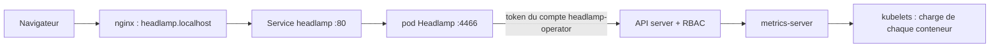

# Monitoring et scaling


# Partie A. Monitoring

## A1. Vue d'ensemble

Le tableau de bord **Headlamp** affiche l'état du cluster (pods, charge CPU et mémoire) et permet de **modifier le nombre de pods** d'un
Deployment, avec des droits volontairement limités.



Headlamp ne stocke rien : c'est un client de l'API Kubernetes. Il transmet **le token de l'utilisateur** ; l'API vérifie qui il est
(authentification), puis ce qu'il a le droit de faire (autorisation, RBAC). Headlamp ne décide d'aucun droit.

## A2. metrics-server

Fichier : `k8s/platform/metrics-server/kustomization.yaml`.

- Référence le manifest officiel (version **0.9.0**) par son adresse et lui applique un **patch** qui ajoute `--kubelet-insecure-tls`
  (les kubelets de kind n'ont pas de certificat signé par l'autorité du cluster ; **à ne pas faire en production**). 
- Chemin d'une commande `kubectl top pods` : le client interroge l'API server, qui transmet les requêtes `metrics.k8s.io` au Service
  `metrics-server` (grâce à un objet `APIService`) ; metrics-server répond avec les dernières mesures qu'il garde **en mémoire** et qu'il relève
  auprès des kubelets (environ toutes les 15 secondes).

```bash
kubectl --context kind-photo apply -k k8s/platform/metrics-server
kubectl --context kind-photo top nodes
kubectl --context kind-photo top pods -n test
```

metrics-server sert l'**autoscaling** et l'affichage de la charge **actuelle** : il ne garde aucun historique et n'envoie aucune alerte.

## A3. Headlamp

Dossier : `k8s/platform/headlamp/`.

| Fichier | Rôle |
|---|---|
| `kubernetes-headlamp.yaml` | copie du manifest officiel : Deployment et Service `headlamp` (port 80 vers 4466) dans `kube-system` |
| `kustomization.yaml` | assemble les fichiers et **fixe la version** de l'image (`ghcr.io/headlamp-k8s/headlamp`, v0.46.0, multi-architecture) |
| `ingress.yaml` | expose `http://headlamp.localhost` par le **même contrôleur nginx** que l'application (un seul point d'entrée) |
| `rbac.yaml` | compte `headlamp-operator` et ses droits |

```bash
kubectl --context kind-photo apply -k k8s/platform/headlamp
curl -s -o /dev/null -w "%{http_code}\n" http://headlamp.localhost      # 200
```

## A4. Accès et droits (RBAC)

Le tableau de bord ne s'utilise pas avec un compte administrateur : le compte `headlamp-operator` (namespace `kube-system`) suit le
**principe du moindre privilège**.

| Objet | Portée | Effet |
|---|---|---|
| `ServiceAccount headlamp-operator` | `kube-system` | l'identité dont on crée le token |
| `ClusterRoleBinding headlamp-view` vers le rôle prédéfini `view` | tout le cluster | **lire** presque tout, dans tous les namespaces (les Secrets sont exclus) |
| `ClusterRole` + `ClusterRoleBinding headlamp-node-reader` | tout le cluster | lire les **nœuds** |
| `ClusterRole headlamp-scaler` : `deployments/scale` (`get`, `update`, `patch`) | modèle de droits, sans effet seul | changer le nombre de replicas |
| `RoleBinding headlamp-scaler` dans `dev` et dans `test` | **ces deux namespaces seulement** | applique le rôle de scaling à ces namespaces |

Pourquoi ces choix :

- Un **`ClusterRole`** est un modèle de droits ; c'est le **binding** qui décide où il s'applique. Relié par un `RoleBinding`, il vaut dans un
  namespace ; relié par un `ClusterRoleBinding`, il vaudrait partout. Le scaling n'est donc volontairement relié que par des `RoleBinding`.
- Les **nœuds** n'appartiennent à aucun namespace : seul un `ClusterRoleBinding` peut donner un droit dessus.
- Pour `view`, un seul `ClusterRoleBinding` évite d'écrire un `RoleBinding` par namespace (et couvre ceux créés plus tard) ; le prix est une lecture
  sur tout le cluster, acceptable ici.
- Les droits **s'additionnent** : il n'existe pas de règle « interdire » ; ce que personne n'autorise est refusé.

Vérification (`kubectl auth can-i`, en se faisant passer pour le compte) : 5 réponses `yes`, 3 `no`.

| Test | Résultat |
|---|---|
| lire les pods de `test` | yes |
| lire les nœuds | yes |
| modifier le scale d'un Deployment dans `test` (`update` et `patch`) | yes |
| modifier le scale d'un Deployment dans `dev` | yes |
| modifier le scale dans `kube-system` | **no** |
| supprimer un Deployment dans `test` | **no** |
| lire un Secret dans `test` | **no** |

```bash
SA=system:serviceaccount:kube-system:headlamp-operator
kubectl --context kind-photo auth can-i patch deployments --subresource=scale -n test --as=$SA
```

(La sous-ressource se précise avec `--subresource=scale` ; écrire `deployments/scale` désignerait un Deployment nommé « scale ».)

**Se connecter** : créer un token de courte durée, à coller dans Headlamp (jamais dans un fichier du dépôt ni dans un message) :

```bash
kubectl --context kind-photo create token headlamp-operator -n kube-system --duration=1h
```

# Partie B. Scaling

## B1. Réserver des ressources : requests et limits

Fichier : `k8s/base/deployment.yaml`.

| Ressource | `requests` (réservé) | `limits` (plafond) |
|---|---|---|
| CPU | 50m | 200m |
| Mémoire | 64Mi | 128Mi |

Les `requests` sont indispensables à l'autoscaling : l'HPA exprime la charge en **pourcentage de la demande**. Sans elles, il ne sait rien calculer.
Les photos reçues (jusqu'à 10 Mo) sont lues en mémoire par l'application ; la limite de mémoire en tient compte.

## B2. Autoscaling horizontal (HPA)

Fichier : `k8s/base/hpa/hpa.yaml`, inclus dans les overlays `test` et `prod`.

| Paramètre | Valeur |
|---|---|
| Cible | Deployment `photo-service` |
| Minimum / maximum | 3 / 6 pods |
| Métrique | CPU, moyenne de **50 %** de la demande (donc 25 millicores par pod) |

Fonctionnement : toutes les quinze secondes environ, l'HPA lit la charge via metrics-server et ajuste le nombre de pods pour ramener la moyenne
à la cible. Il **ajoute des pods rapidement** mais en **retire lentement** (fenêtre de stabilisation de cinq minutes par défaut) : la réduction
ne se voit pas tout de suite après la fin d'une charge.

```bash
kubectl --context kind-photo get hpa -n test -w
kubectl --context kind-photo top pods -n test
```

## B3. Scaling manuel

Depuis Headlamp (action *Scale*, qui passe par la sous-ressource `scale`), ou en ligne de commande :

```bash
kubectl --context kind-photo scale deployment/photo-service -n test --replicas=5
```

Avec l'HPA actif, un scaling manuel est **temporaire** : l'autoscaler ramène le nombre de pods dans sa plage selon la charge (après la fenêtre de
stabilisation). Pour une démonstration du scaling manuel, l'HPA a le dernier mot : il faut le préciser.

## B5. Test de charge

But : montrer que l'HPA **ajoute des pods quand la charge monte** et **en retire quand elle cesse**.

### Outil et principe

Le script `scripts/loadtest.sh` n'a besoin que de `curl`. Il lance plusieurs clients en parallèle qui envoient des requêtes en boucle à
`http://<env>.photo.localhost/version`, pendant une durée donnée. Cette route est un bon choix : elle traverse tout le chemin
(Ingress, Varnish, Service, pod) et Varnish **ne la met pas en cache** (il ne cache que `/static/`), donc chaque requête arrive jusqu'à un pod.

Toutes les 10 secondes, le script relève l'état de l'HPA (pods actuels, pods voulus, CPU moyen en % de la demande). Quand la charge s'arrête, il continue
d'observer jusqu'au retour au minimum, puis affiche le nombre de requêtes par code HTTP.

```bash
scripts/loadtest.sh test 180 40     # environnement, durée en secondes, clients en parallèle
```

Pour suivre la même chose dans l'interface : `kubectl --context kind-photo get pods -n test -w` dans un second terminal, et Headlamp dans le navigateur.

### Ce qu'on doit observer

| Phase | Ce que fait l'HPA |
|---|---|
| Avant la charge | 3 pods (minimum), CPU moyen très bas |
| Charge | le CPU moyen dépasse 50 % de la demande (25 millicores par pod) : l'HPA calcule `pods voulus = ceil(pods actuels x CPU mesuré / 50 %)`, plafonné à 6, et **ajoute des pods rapidement** |
| Après la charge | le CPU retombe, mais l'HPA attend la **fenêtre de stabilisation de 5 minutes** avant de retirer des pods : le retour à 3 se fait environ 5 minutes après l'arrêt |

Exemple du calcul : avec 3 pods à 150 % de CPU, `ceil(3 x 150 / 50) = 9`, ramené au maximum de **6**.
